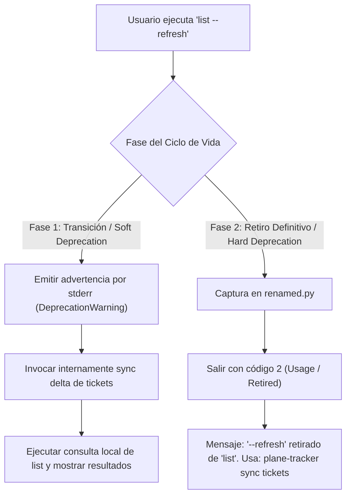
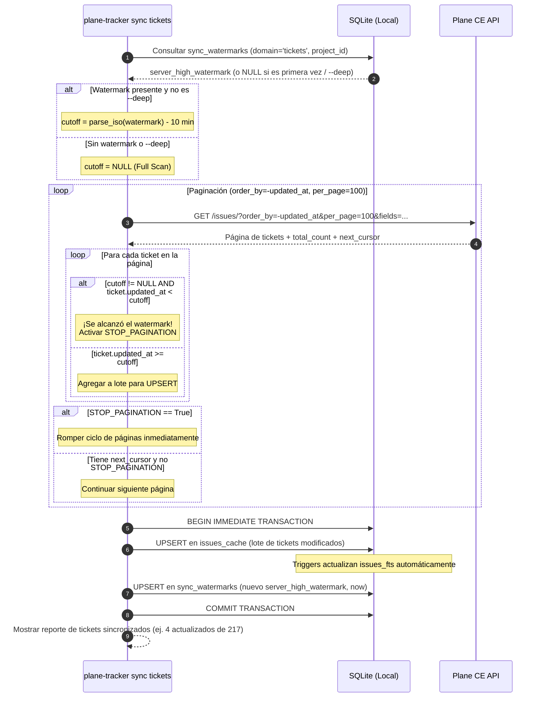
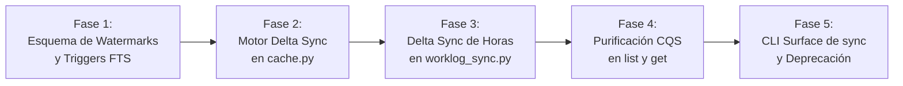

# 0026 · Sincronización incremental, granularidad en sync y separación CQS

- **Área:** comandos de sincronización (`sync`), comandos de lectura (`list`, `get`), motor de caché (`cache.py`), sincronización de telemetría (`worklog_sync.py`), esquema SQLite (`db.py`) y contrato de adquisición (`freshness.py`).
- **Principios rectores:** Separación Comando-Consulta (CQS), Local-First estricto, Economía de peticiones y cuota de tasa (Rate Budget), Determinismo en lecturas, y Transaccionalidad ACID en SQLite.
- **Contexto:** El CLI opera contra la API de Plane CE v1.2.3 con base de datos local SQLite (`~/.cache/plane/worklogs.db`). El usuario principal es un agente de IA y desarrolladores de ingeniería que requieren respuestas inmediatas (<5ms) en consultas de Momento Cero y sincronizaciones eficientes sin saturar el servidor ni agotar la tasa de peticiones.

---

## 1. Contexto y Evidencia Verificada

El análisis del código fuente y los tests de `plane-tracker` revela dos problemas estructurales graves en la arquitectura actual:

### 1.1. Acoplamiento de Lectura y Mutación (Violación de CQS)
En `scripts/plane_cli/cmd_read.py` y `freshness.py`, el comando `list` no es una consulta pura:
1. `cmd_list` llama a `freshness.ensure(conn, env, "list", scope, cats)`, el cual llama a `_ensure_issues`.
2. Si el TTL de 30 minutos venció, si nunca se ha sincronizado el proyecto, o si el usuario pasa `--refresh`, `_ensure_issues` invoca `cache.sync_project_issues`.
3. `sync_project_issues` realiza llamadas HTTP contra la API de Plane, muta la base de datos local (`DELETE FROM issues_cache`, `DELETE FROM issues_fts`, `INSERT INTO issue_sync`), alterando el estado persistente durante lo que debería ser una operación de solo lectura (`SELECT`).
4. **Consecuencias:**
   - **Latencia impredecible:** Una invocación de rutina de `list` pasa de tomar ~3ms (lectura SQLite local) a tomar 3.000ms - 8.000ms si el TTL expiró o si la red está lenta.
   - **Bloqueos de concurrencia:** Cuando múltiples sesiones de agentes o subagentes ejecutan `plane-tracker list` en paralelo, compiten por bloqueos exclusivos de escritura en SQLite, provocando errores de contención.
   - **Agotamiento de cuota de tasa (Rate Limiting):** Consultas frecuentes disparan barridos innecesarios de red, consumiendo las 60 peticiones/minuto permitidas por Plane CE.
   - **Ambigüedad cognitiva para agentes:** El agente de IA no tiene certeza de si `list` es local o remoto, y el flag `--refresh` fomenta su uso indiscriminado en búsquedas cotidianas.

### 1.2. `sync` Monolítico y Sin Sincronización Incremental (Deep Sync Ciego)
En `scripts/plane_cli/cmd_sync.py`, `cache.py` y `worklog_sync.py`:
1. **Destrucción masiva en tickets:** Cada vez que se sincronizan tickets, `cache.py:149` ejecuta `DELETE FROM issues_cache WHERE project_id = ?` y reinserta fila por fila. Acto seguido, borra y repuebla toda la tabla virtual `issues_fts`.
2. **Paginación exhaustiva sin filtro de tiempo:** `_fetch_all_issues` en `cache.py` recorre hasta 20 páginas de 100 tickets mediante cursor sin ningún filtro de fecha ni condición de parada temprana. En proyectos con cientos de tickets, esto consume de 5 a 15 peticiones GET solo para descubrir que nada o casi nada cambió.
3. **Ventana fija arbitraria de 30 días en worklogs:** `worklog_sync.py:216` calcula `cutoff = date_from - 1 día` (que por defecto en `sync` es `today - 30 días`). Siempre evalúa 30 días de candidatos hacia atrás, aun cuando la última sincronización ocurrió hace 10 minutos.
4. **Falta de granularidad:** El comando `sync` ejecuta tickets Y worklogs de manera monolítica. No existe la capacidad de decir: "sincroniza únicamente los tickets del proyecto OMNIFY" o "sincroniza únicamente las horas de esta semana".

### Tabla de Evidencia Verificada en el Código

| Hecho Verificado | Archivo y Líneas | Consecuencia Técnica |
| :--- | :--- | :--- |
| `list` dispara sincronización de red y mutaciones SQLite | `cmd_read.py:49`, `freshness.py:119-127` | Violación de CQS. Latencia errática en consultas de Momento Cero. |
| Borrado total de la caché de tickets en cada sync | `cache.py:149-164` | `DELETE FROM issues_cache` destruye índices e invalida el cache de páginas SQLite. Reconstrucción O(N) de FTS. |
| Paginación completa de tickets sin parada anticipada | `cache.py:60-74` | Descarga de N páginas aunque solo 1 ticket haya cambiado. Desperdicio de peticiones y tiempo de CPU/red. |
| Ventana fija de 30 días hardcodeada en telemetría | `cmd_sync.py:66-68`, `worklog_sync.py:216` | Barrido repetitivo e innecesario de 30 días de historial de comentarios en cada ejecución de `sync`. |
| Filtros de servidor ignorados por Plane CE v1.2.3 | `hechos-de-la-api.md:13` | Plane ignora `updated_at__gte` silenciosamente. La detección de corte **debe** ser local con `order_by=-updated_at`. |
| Límite de tasa de 60 peticiones por ventana | `cache.py:21`, `hechos-de-la-api.md:50-55` | 1 sync monolítico de 2 proyectos consume hasta el 40% del presupuesto de la ventana. |
| Inexistencia de tabla de marcas de agua unificada | `db.py:262-294` | `issue_sync` y `worklog_sync` guardan metadatos fragmentados y dispares sin seguimiento granular de deltas. |

---

## 2. Principios de Diseño Arquitectónico

### 2.1. Separación Comando-Consulta (CQS) al estilo Git
- **Consultas Puras (Read-Only Queries):** `list`, `get`, `report time`, `report flow`, `labels`, `projects`, `whoami`.
  - Leen **únicamente** de SQLite (`issues_cache`, `worklogs`, `states`, `labels`, `members`).
  - Tienen efecto secundario nulo (cero escrituras en disco, cero peticiones a la red).
  - Tiempo de ejecución predecible: `< 5 ms` para `list --text` (Momento Cero).
  - La cobertura (`Coverage`) informa con total transparencia si los datos provienen de caché, su antigüedad (`age_s`) y si están obsoletos (`stale: true`), ofreciendo una pista (`hint: "plane-tracker sync tickets"`).
- **Comandos de Mutación / Mantenimiento:** `sync` (y comandos de escritura como `create`, `update`, `comment add`).
  - `sync` es el **único** comando responsable de contactar la API remota de Plane para actualizar el estado local de lectura.

### 2.2. Sincronización Delta Incremental (High-Watermark Sync)
- **High Watermark (Marca de Agua Alta):** Se almacena el timestamp más reciente observado del servidor (`server_high_watermark`) por proyecto y por dominio.
- **Tolerancia a Desfase de Reloj (Skew Tolerance Buffer):** Debido a posibles discrepancias de milisegundos entre el reloj de la máquina local y el servidor de Plane, o transacciones en curso en el backend de Plane, se aplica un buffer de seguridad `SKEW_BUFFER = 10 minutos` (600s). El corte de sincronización se evalúa como:
  $$\text{cutoff} = \text{server\_high\_watermark} - \text{SKEW\_BUFFER}$$
- **Paginación con Parada Temprana (Early-Exit Pagination):**
  Aprovechando que Plane CE v1.2.3 soporta `order_by=-updated_at` (orden descendente estricto por última modificación), el cliente pagina hacia adelante. En cuanto encuentra un ticket cuyo `updated_at < cutoff`, **detiene inmediatamente la paginación**. No se solicitan más páginas.
- **Operaciones Atómicas `UPSERT`:**
  En lugar de borrar la tabla, se realiza `INSERT ... ON CONFLICT(id) DO UPDATE SET ...`. Solo se tocan las filas modificadas.
- **Mantenimiento FTS Reactivo mediante Triggers:**
  En lugar de vaciar y repoblar `issues_fts` en Python, se instalan triggers en SQLite (`AFTER INSERT`, `AFTER UPDATE`, `AFTER DELETE`) que sincronizan la tabla virtual FTS5 en microsegundos y de forma transaccional.

### 2.3. Transaccionalidad ACID y WAL
- Todas las inserciones del lote delta y la actualización del watermark se ejecutan dentro de una única transacción SQLite (`BEGIN IMMEDIATE` ... `COMMIT`).
- Si la conexión se interrumpe o el script se detiene a mitad de camino, la base de datos queda intacta y el watermark anterior permanece válido.

---

## 3. Rediseño Ergonómico de la CLI (CLI Surface Design)

### 3.1. Superficie de Comandos: El Grupo `sync` con Dominio Opcional

Siguiendo las restricciones de `ARCHITECTURE.md` (árbol de comandos compacto, respeto al presupuesto de ayuda global de 280 tokens en `test_cli_tree.py`):
`sync` se mantiene como verbo raíz, pero admite un argumento posicional de dominio opcional (`TARGET`), acompañado de flags de alcance y controles.

```bash
plane-tracker sync [TARGET] [-p PRJ] [--all-projects] [--deep] [--week|--from|--to] [--history] [--budget N] [--json]
```

#### Valores de `TARGET` (Posicional Opcional):
| TARGET | Responsabilidad | Comportamiento Delta |
| :--- | :--- | :--- |
| *(omitido)* o `all` | Sincronización estándar integral | Sincroniza tickets (delta), horas del periodo activo (delta) y catálogos vencidos. |
| `tickets` | Exclusivamente tickets | Descarga tickets modificados desde el último watermark y actualiza `issues_cache`. |
| `hours` | Exclusivamente telemetría / worklogs | Descarga comentarios de tickets con actividad desde el watermark de horas y actualiza `worklogs`. |
| `catalogs` | Catálogos y metadatos | Refresca estados (`states`), etiquetas (`labels`), miembros (`members`) y proyectos. |
| `ticket <ID>` | Un ticket específico (ej: `OMNIFY-175`) | Trae el ticket y sus comentarios puntuales en 1-2 GETs y guarda la instantánea en `issue_snapshots`. |

#### Flags Clave de `sync`:
- `-p PRJ, --project PRJ`: Limita la sincronización al proyecto especificado (por defecto, el configurado en el entorno).
- `--all-projects`: Sincroniza todos los proyectos accesibles del workspace.
- `--deep` / `--full`: **Reconciliación profunda (Deep Sync)**. Invalida temporalmente los watermarks locales:
  - En tickets: recorre todas las páginas, reconcilia tickets eliminados o archivados, reconstruye el índice FTS5.
  - En hours: ignora el watermark y barre los últimos 30 días releyendo comentarios.
  - En catalogs: fuerza `force_refresh=True` ignorando los TTLs.
- `--from YYYY-MM-DD`, `--to YYYY-MM-DD`, `--week`: Aplica solo cuando se sincronizan horas (`hours` o `all`).
- `--history`: Trae el historial de transiciones de estado y eventos de asignación para tickets pendientes.
- `--budget N`: Límite defensivo de peticiones a la API para no agotar la tasa (por defecto 25 con `--history`, 10 en llamadas delta).

### 3.2. Purificación de `list` y `get`
1. **`list` (Consulta Pura):**
   - Elimina la mutación oculta. Lee directamente de `issues_cache`.
   - Si no hay datos locales o si los datos están vencidos (`age_s > 1800`), `Coverage` incluye:
     `stale: true`, con la nota `hint: "Usa 'plane-tracker sync tickets' para actualizar"`.
   - Tiempo de respuesta garantizado: `< 5 ms`.
2. **`get` (Inspección Pura / Local-First):**
   - `plane-tracker get <TICKET>` lee la instantánea guardada en `issue_snapshots` o los metadatos de `issues_cache`.
   - Si el usuario desea traer la versión en vivo más reciente de un ticket específico, ejecuta:
     `plane-tracker sync ticket <TICKET>` y luego `plane-tracker get <TICKET>`, o bien se proporciona el flag `--sync` en `get` para refrescar exclusivamente ese ticket en línea.

### 3.3. Plan de Deprecación y Retrocompatibilidad para `--refresh` en `list`
Para evitar romper scripts existentes y no desorientar a los agentes de IA de forma inmediata:



1. **Fase 1 (Transición / Soft Deprecation):**
   - El flag `--refresh` en `list` se marca como deprecado en la ayuda.
   - Si se invoca `plane-tracker list --refresh`:
     - Imprime en `sys.stderr`:
       `⚠ '--refresh' en 'list' está deprecado (viola CQS). Se sincronizarán los tickets en segundo plano. En el futuro usa 'plane-tracker sync tickets && plane-tracker list'.`
     - Ejecuta la sincronización delta de tickets antes de resolver la consulta.
     - En la salida `--json`, adjunta la nota correspondiente:
       `{"code": "deprecated_flag", "level": "warn", "message": "--refresh en list está deprecado; usa plane-tracker sync tickets"}`
2. **Fase 2 (Retiro Definitivo / Hard Deprecation):**
   - Se retira el flag `--refresh` de la vista `list` (`views.py` y `scope_flags.py`).
   - `renamed.py` intercepta el intento de uso y devuelve error de sintaxis asistido (código 2):
     `Error: '--refresh' ha sido retirado de 'list'. Para actualizar los datos ejecuta: 'plane-tracker sync tickets'.`

---

## 4. Motor de Sincronización Delta Basado en Timestamps

### 4.1. Esquema SQLite: Tabla Unificada `sync_watermarks`

Se agrega a `scripts/plane_cli/db.py` la tabla `sync_watermarks` para centralizar la telemetría de sincronización:

```sql
CREATE TABLE IF NOT EXISTS sync_watermarks (
    domain TEXT NOT NULL CHECK (domain IN ('tickets', 'hours', 'catalogs', 'history')),
    project_id TEXT NOT NULL,              -- UUID del proyecto, o '' / 'GLOBAL'
    last_sync_timestamp REAL NOT NULL,     -- Instante UNIX (segundos flotantes) del cliente
    server_high_watermark TEXT,            -- updated_at ISO-8601 UTC máximo devuelto por Plane
    status TEXT NOT NULL DEFAULT 'success' CHECK (status IN ('success', 'partial', 'rate_limited', 'failed')),
    items_synced INTEGER NOT NULL DEFAULT 0,
    pages_fetched INTEGER NOT NULL DEFAULT 0,
    duration_ms INTEGER NOT NULL DEFAULT 0,
    updated_at REAL NOT NULL,              -- Instante UNIX del registro
    PRIMARY KEY (domain, project_id)
);

CREATE INDEX IF NOT EXISTS idx_sync_watermarks_lookup 
    ON sync_watermarks(domain, project_id, status);
```

### 4.2. Triggers SQLite para Mantenimiento Automático de FTS5

Para eliminar el costoso y destructivo `DELETE FROM issues_fts; INSERT INTO issues_fts ...`, se registran triggers en SQLite que sincronizan la tabla virtual FTS5 inmediatamente ante cualquier cambio en `issues_cache`:

```sql
CREATE TRIGGER IF NOT EXISTS trg_issues_cache_ai AFTER INSERT ON issues_cache
BEGIN
    DELETE FROM issues_fts WHERE ticket_id = new.ticket_id;
    INSERT INTO issues_fts (ticket_id, title, labels_csv) 
    VALUES (new.ticket_id, new.title, new.labels_csv);
END;

CREATE TRIGGER IF NOT EXISTS trg_issues_cache_au AFTER UPDATE ON issues_cache
BEGIN
    DELETE FROM issues_fts WHERE ticket_id = new.ticket_id;
    INSERT INTO issues_fts (ticket_id, title, labels_csv) 
    VALUES (new.ticket_id, new.title, new.labels_csv);
END;

CREATE TRIGGER IF NOT EXISTS trg_issues_cache_ad AFTER DELETE ON issues_cache
BEGIN
    DELETE FROM issues_fts WHERE ticket_id = old.ticket_id;
END;
```

### 4.3. Algoritmo Detallado de Delta Sync para Tickets



#### Pseudocódigo del Algoritmo en `cache.py`:
```python
def sync_project_issues_delta(conn, base_url, api_key, workspace, project_id, project_ident, deep=False):
    watermark = get_watermark(conn, "tickets", project_id)
    cutoff = None
    if watermark and watermark["server_high_watermark"] and not deep:
        # Buffer de seguridad de 10 minutos (skew tolerance)
        wm_dt = datetime.fromisoformat(watermark["server_high_watermark"].replace("Z", "+00:00"))
        cutoff = wm_dt - timedelta(minutes=10)

    url_base = f"{base_url.rstrip('/')}/api/v1/workspaces/{workspace}/projects/{project_id}/issues/"
    cursor = None
    pages = 0
    synced_issues = []
    stop_pagination = False
    server_high = watermark["server_high_watermark"] if watermark else None
    server_total_count = None

    while pages < ISSUES_MAX_PAGES and not stop_pagination:
        _check_budget()
        params = f"?order_by=-updated_at&per_page=100&fields={ISSUE_FIELDS}"
        if cursor:
            params += f"&cursor={urllib.parse.quote(cursor)}"
        
        data = api_request(url_base + params, api_key, raise_on_error=True)
        pages += 1
        results = data.get("results", [])
        server_total_count = data.get("total_count", server_total_count)

        for iss in results:
            iss_updated = iss.get("updated_at")
            if iss_updated:
                if not server_high or iss_updated > server_high:
                    server_high = iss_updated
                if cutoff:
                    iss_dt = datetime.fromisoformat(iss_updated.replace("Z", "+00:00"))
                    if iss_dt < cutoff:
                        stop_pagination = True
                        break
            synced_issues.append(iss)

        cursor = data.get("next_cursor")
        if not data.get("next_page_results") or not cursor:
            break

    # Persistencia atómica en SQLite con UPSERT
    now = clock.timestamp()
    label_names = _label_names_by_id(conn, project_id)
    state_items = api_request(f"{base_url.rstrip('/')}/api/v1/workspaces/{workspace}/projects/{project_id}/states/", api_key).get("results", [])
    states_by_id = {s["id"]: (s["name"], s.get("group", "")) for s in state_items}

    with conn:
        # 1. Actualizar estados
        _upsert_states(conn, project_id, state_items, now)
        
        # 2. UPSERT en issues_cache (triggers actualizan issues_fts)
        for iss in synced_issues:
            _upsert_single_issue(conn, project_id, project_ident, iss, states_by_id, label_names, now)

        # 3. Reconciliación de borrados si aplica
        _reconcile_deletions_if_needed(conn, project_id, server_total_count, deep)

        # 4. Actualizar marca de agua
        save_watermark(conn, domain="tickets", project_id=project_id,
                       server_high_watermark=server_high, items_synced=len(synced_issues),
                       pages_fetched=pages, status="success", as_of=now)

    return "synced", now, len(synced_issues)
```

### 4.4. Detección de Borrados y Archivados sin Full-Scan Diario
¿Cómo detectar tickets borrados en Plane si la sincronización delta solo descarga modificados?

1. **Tickets Archivados:**
   Plane CE marca los tickets archivados con el campo `archived_at` y actualiza su `updated_at`. Por tanto, el delta sync los recibe naturalmente en el lote de modificados y actualiza su fila en `issues_cache`. Las consultas estándar filtran `archived_at IS NULL`.
2. **Tickets Eliminados Definitivamente (Hard Deletions):**
   - En cada respuesta de página, Plane devuelve `total_count` (el total de tickets activos en el servidor).
   - Se compara contra el conteo local:
     $$\text{local\_count} = \text{SELECT COUNT(*) FROM issues\_cache WHERE project\_id = ? AND archived\_at IS NULL}$$
   - **Si `local_count == server_total_count`:** Se garantiza integridad exacta; no hubo eliminaciones.
   - **Si `local_count > server_total_count`:** Se ha detectado una anomalía (drift: 1 o más tickets fueron borrados en Plane).
     - **Modo Normal:** Se emite una nota en el reporte: `drift_detected: true`.
     - **Reconciliación Ligera de IDs (Lightweight Key Audit):**
       En lugar de descargar títulos, descripciones y metadatos, se ejecuta una consulta ultra-liviana paginada:
       `GET /issues/?per_page=100&fields=id` (peso: ~3 KB por página).
       Se extrae el conjunto de IDs del servidor y se ejecuta:
       ```sql
       DELETE FROM issues_cache 
       WHERE project_id = ? AND id NOT IN (SELECT value FROM json_each(?));
       ```
     - Si se pasa `--deep`, esta reconciliación se ejecuta de manera obligatoria y exhaustiva.

### 4.5. Algoritmo de Delta Sync para Worklogs y Telemetría

En la implementación actual (`worklog_sync.py`), se evalúa siempre una ventana estática de 30 días (`cutoff = today - 30 days`).
Con la arquitectura delta:
1. Se consulta `sync_watermarks` para `domain='hours'` y el proyecto correspondiente.
2. Si existe un `server_high_watermark` previo y el usuario no especificó `--from` ni `--deep`:
   - Se establece `cutoff = watermark.date - 1 día` (buffer defensivo de 24 horas para comentarios ingresados con fecha retroactiva o cambio de huso horario).
   - En lugar de 30 días de candidatos, se examinan típicamente solo 1 o 2 días.
3. Se obtienen los tickets candidatos con `order_by=-updated_at` y parada temprana.
4. Para los tickets cuyos comentarios ya se leyeron y cuyo `updated_at` no cambió, se omite la descarga gracias a `worklog_issue_sync` (`_unchanged`).
5. Se ingieren las nuevas telemetrías con `upsert_worklog` y se actualiza `sync_watermarks` para `hours`.

---

## 5. Resiliencia, Concurrencia y Circuit Breaker

### 5.1. Manejo Transaccional en SQLite
- **Modo WAL y Tiempos de Espera:**
  `db.py` ya inicializa SQLite con `PRAGMA journal_mode = WAL;`. Se refuerza con:
  - `PRAGMA busy_timeout = 15000;` (15 segundos de tolerancia a contención antes de emitir `database is locked`).
  - `PRAGMA synchronous = NORMAL;` (seguridad completa en caídas de proceso con óptimo rendimiento en disco).
- **Control de Concurrencia de Sincronización:**
  Para evitar que dos procesos o subagentes ejecuten `plane-tracker sync` de manera simultánea en la misma máquina, se implementa un cerrojo a nivel de archivo con `fcntl.flock`:
  - Archivo: `~/.cache/plane/sync.lock`.
  - Si un proceso intenta hacer sync mientras otro está en curso:
    - Sin bloqueo (`LOCK_NB`): aborta de inmediato con aviso elegante:
      `ℹ Otra sincronización está en curso (PID 12345). Espera a que finalice o consulta la caché local.`

### 5.2. Presupuesto de Tasa y Detención Preventiva (Rate Limiter Safety)
- Plane CE aplica un límite de 60 peticiones por ventana.
- Antes de cada petición en el bucle de paginación o descarga de comentarios:
  - Se inspecciona el estado de tasa actual con `api.rate_limit()`.
  - Si `remaining <= RATE_RESERVE` (3 peticiones):
    - Se aborta el bucle inmediatamente lanzando `RateBudgetExhausted`.
    - La transacción en SQLite guarda todo lo descargado hasta la última página completa.
    - Se actualiza `sync_watermarks` con `status: 'rate_limited'`.
    - La salida informa:
      `⚠ Presupuesto de tasa casi agotado (3 peticiones restantes). Sincronización pausada de forma segura; reanuda con 'plane-tracker sync'.`

---

## 6. Plan de Implementación y Fases

Para garantizar cero regresiones y respetar el trinquete de arquitectura (máximo 450 líneas por archivo, suite de pruebas 100% verde en cada fase), el plan se estructura en 5 fases incrementales:



### Fase 1: Esquema de Watermarks y Triggers SQLite
- **Archivos a modificar:**
  - `scripts/plane_cli/db.py`:
    - Añadir creación de tabla `sync_watermarks`.
    - Añadir creación de triggers `trg_issues_cache_ai`, `trg_issues_cache_au`, `trg_issues_cache_ad` sobre `issues_cache`.
  - `scripts/plane_cli/store_issues.py`:
    - Funciones de lectura y persistencia de watermarks: `get_watermark()`, `set_watermark()`.
- **Aceptación:**
  - Pruebas unitarias de creación de tabla, índices y funcionamiento de triggers ante inserción/actualización en `issues_cache`.

### Fase 2: Motor Delta Sync de Tickets
- **Archivos a modificar:**
  - `scripts/plane_cli/cache.py`:
    - Reemplazar `_fetch_all_issues` por paginación con `order_by=-updated_at` y parada temprana por cutoff.
    - Reemplazar `DELETE FROM issues_cache` por `UPSERT` en SQLite.
    - Retirar el borrado y repoblación manual de `issues_fts` (los triggers de SQLite asumen la responsabilidad).
    - Implementar detección de borrados mediante comparación de `server_total_count` vs `local_count`.
    - Soporte para flag `deep=True`.
- **Aceptación:**
  - En un proyecto con 100 tickets y solo 1 modificado, la sincronización se detiene en la página 1 consumiendo exactamente 1 GET de tickets.

### Fase 3: Motor Delta Sync de Horas / Telemetría
- **Archivos a modificar:**
  - `scripts/plane_cli/worklog_sync.py`:
    - Leer el watermark previo de horas.
    - Si no se pasa `--from` ni `--deep`, usar `cutoff = watermark.date - 1 día` en lugar de `today - 30 días`.
    - Guardar el nuevo watermark en `sync_watermarks`.
- **Aceptación:**
  - Reducción de la ventana de búsqueda de candidatos de 30 días a 1-2 días en sincronizaciones cotidianas.

### Fase 4: Purificación CQS en `list` y `get`
- **Archivos a modificar:**
  - `scripts/plane_cli/freshness.py`:
    - En `ensure("list")`: eliminar la llamada a `_ensure_issues` que disparaba llamadas de red y mutaciones de base de datos.
    - `ensure("list")` se convierte en un verificador de cobertura puramente local. Si no hay datos locales o están vencidos, marca `stale: true` y añade nota con sugerencia de sincronización.
  - `scripts/plane_cli/cmd_read.py`:
    - `cmd_list`: pureza absoluta de lectura.
    - Manejo de transición para `--refresh`: si se pasa, muestra aviso en stderr (DeprecationWarning) y llama a `sync` antes de listar.
  - `scripts/plane_cli/views.py` y `scope_flags.py`:
    - Actualizar metadatos de la vista `list` para documentar la pureza de lectura.
- **Aceptación:**
  - `plane-tracker list --text "test"` tarda < 5ms sin importar si el TTL expiró o si la máquina no tiene conexión a Internet, sin necesidad de pasar `--offline`.

### Fase 5: Rediseño de la Superficie CLI de `sync`
- **Archivos a modificar:**
  - `scripts/plane_cli/cmd_sync.py`:
    - Soporte de targets: `sync tickets`, `sync hours`, `sync catalogs`, `sync ticket <ID>`, `sync all`.
    - Soporte del flag `--deep`.
    - Salida estructurada de resumen (`_text` y `_summary`).
  - `scripts/plane_cli/renamed.py`:
    - Ayudas de redirección para flags retirados o deprecados.
  - `tests/test_cli_tree.py`:
    - Validar que el presupuesto de ayuda global no exceda los 280 tokens.
- **Aceptación:**
  - `plane-tracker sync tickets -p OMNIFY` ejecuta exclusivamente la sincronización de tickets de ese proyecto.
  - La suite de pruebas de comandos y árboles de CLI pasa al 100%.

---

## 7. Pruebas Automatizadas Requeridas

Para salvaguardar la robustez del sistema, se deben implementar o actualizar las siguientes pruebas en `tests/`:

1. **Pruebas de Delta Sync con Reloj Congelado (`test_sync_command.py`):**
   - **Caso 1: Sincronización en Frío (Cold Start):** Sin watermark previo, descarga todas las páginas necesarias y establece el watermark inicial.
   - **Caso 2: Sincronización Delta con Parada Temprana:** Se avanza el reloj con `plane_clock.py`. Se simula que 1 ticket fue actualizado en el servidor. El sync debe detenerse en la página 1 y realizar 1 única petición GET de issues.
   - **Caso 3: Idempotencia y UPSERT:** Ejecutar sync dos veces seguidas sin cambios en el servidor debe reportar 0 tickets actualizados y 1 sola petición GET.
   - **Caso 4: Flag `--deep`:** Con `--deep`, se fuerza la relectura de todas las páginas ignorando el watermark.
2. **Pruebas de Pureza CQS en `list` (`test_list_view.py` y `test_offline_reads.py`):**
   - Ejecutar `plane-tracker list` con un servidor falso (`fake_server`) que registra peticiones. Verificar que el contador de peticiones entrantes es estrictamente 0.
   - Verificar que `plane-tracker list` sobre una base con TTL expirado responde de inmediato (<5ms) marcando `Coverage.stale = True` sin fallar ni bloquear.
3. **Pruebas de Granularidad de `sync`:**
   - `plane-tracker sync tickets`: verificar que solo toca `issues_cache` y no altera `worklogs`.
   - `plane-tracker sync hours`: verificar que solo actualiza `worklogs` y no pagina tickets innecesariamente.
   - `plane-tracker sync catalogs`: verificar que refresca `states`, `labels`, `members` y `projects`.
4. **Pruebas Estructurales y Trinquete de Arquitectura (`test_structure.py`, `test_cli_tree.py`):**
   - Asegurar que ningún archivo modificado sobrepase las 450 líneas.
   - Verificar que el presupuesto de ayuda global (`root.format_help() / 4 <= 280`) se mantiene estricto.
   - Verificar que no hay lecturas directas de la hora fuera de `plane_cli.clock`.

---

## 8. Análisis de Beneficios e Impacto

| Métrica / Dimensión | Implementación Actual (Monolítica / Sin Delta) | Nueva Arquitectura (Delta Sync + CQS) | Beneficio Obtenido |
| :--- | :--- | :--- | :--- |
| **Latencia de `plane-tracker list`** | 3.000 ms - 8.000 ms (si venció TTL) | **< 5 ms constante** (local-first) | **~1.000x más rápido** en lecturas cotidianas. |
| **Peticiones HTTP en un `sync` rutinario** | 15 - 35 peticiones GET | **2 - 4 peticiones GET** | **~85% de reducción** en tráfico de red. |
| **Consumo de Cuota de Tasa (Rate Limit)** | 25% - 50% de la ventana de 60 req | **3% - 6% de la ventana** | Elimina prácticamente el riesgo de `RateBudgetExhausted`. |
| **I/O en SQLite por sincronización** | `DELETE` total de N filas + rebuild FTS | `UPSERT` puntual de 1-3 filas + triggers | Reducción de escrituras en disco y fragmentación WAL. |
| **Contención de Procesos Concurrentes** | Errores de bloqueo en SQLite al listar | Lecturas sin bloqueo gracias a CQS y WAL | Ejecución fluida de múltiples subagentes en paralelo. |
| **Claridad y Ergonomía para Agentes IA** | Confusión con `--refresh` en `list` | CQS estricto: `list` es consulta, `sync` es comando | Cero ambigüedad en planes de ejecución y llamadas CLI. |

---

## 9. Alternativas Descartadas

1. **Filtro del lado del servidor en Plane API (`updated_at__gte`):**
   - *Descartada:* La API de Plane CE v1.2.3 ignora silenciosamente los filtros de fecha y límite en `issues/?`. No es viable delegar el filtrado temporal al servidor. La parada temprana local con `order_by=-updated_at` es la única solución compatible.
2. **Polling en segundo plano (Daemon / Cron silencioso):**
   - *Descartada:* Viola el principio de control explícito y simplicidad de `plane-tracker`. Un demonio en background añade complejidad de procesos huérfanos, consumo de batería y saturación invisible de cuota de red. La sincronización bajo demanda explícita (`plane-tracker sync`) mantiene la herramienta predecible.
3. **Subcomandos jerárquicos forzados (`plane-tracker sync -> error 2: verb required`):**
   - *Descartada:* Rompe la experiencia de usuario y scripts que invocan `plane-tracker sync`. Adoptar un target posicional opcional (`plane-tracker sync [TARGET]`) con valor por defecto `all` preserva la retrocompatibilidad y añade granularidad sin fricción.
