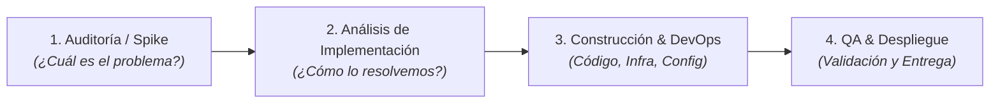

# Estrategia Integral de Gestión de Tiempos, Work Items y Productividad para TI
## De "Hombre Orquesta" a Ingeniero de Alto Rendimiento Visible

> **Autor:** Johan Tanta & Asistentes de Ingeniería (AI Architecture)  
> **Ubicación:** `agents/skills/work/plane-tracker/references/ESTRATEGIA_GESTION_TI_Y_WORKITEMS.md`  
> **Plataforma:** Plane Community Edition v1.2.3 (`teamprogra` / Omnify)  
> **Versión:** 1.0.0 — Octubre 2026  

---

## 1. El Diagnóstico Real: La Paradoja del "Hombre Orquesta"

En equipos ágiles o en crecimiento, un desarrollador senior rara vez solo "escribe código". Asumes simultáneamente 6 roles críticos:

```
┌────────────────────────────────────────────────────────────────────────┐
│                        JOHAN TANTA (Roles Reales)                      │
├──────────────┬──────────────┬──────────────┬─────────────┬─────────────┤
│ 1. Auditor   │ 2. Backend / │ 3. DevOps &  │ 4. QA /     │ 5. Soporte /│
│    Forense   │    Frontend  │    SRE       │    Testing  │    Atención │
│ (Datos, BD)  │ (Features)   │ (Docker, VM) │ (Reálculo)  │ (Usuarios)  │
├──────────────┴──────────────┴──────────────┴─────────────┴─────────────┤
│                       + 6. Reuniones y Coordinación                    │
└────────────────────────────────────────────────────────────────────────┘
```

### ¿Por qué el formato básico del Jefe ("titulo, inicio, fin") falla?
1. **La falacia de las 8 horas de código:** Gerencia suele asumir ingenuamente que una jornada de 8 horas equivale a 8 horas continuas de tecleo de features. Si solo registras horas cuando programas, parece que solo trabajaste 3 o 4 horas al día.
2. **El "Toil" y las Interrupciones Invisibles:** Responder consultas del área usuaria (*"¿por qué falló este SMS?", "¿cómo saco este reporte?"*), investigar logs y asistir a reuniones son tareas que consumen entre el 30% y el 50% de la energía diaria. Si no se cuantifican, desaparecen del radar gerencial.
3. **El Context-Switching:** Cambiar de depurar un Docker a atender a un usuario y luego volver a un script SQL cuesta 15-20 minutos de re-concentración.

---

## 2. La Regla de los 3 Baldes de Capacidad (Industry Standard)

Equipos de ingeniería maduros (Google SRE, Stripe, Spotify) gestionan la jornada mediante la regla de los **3 Baldes**:

| Balde | Tipo de Trabajo | % Realista de Jornada | ¿Dónde vive en Plane? |
| :--- | :--- | :---: | :--- |
| **Balde 1: Ingeniería & Producto (Deep Work)** | Auditoría, Análisis de Implementación, Backend, Frontend, DevOps y QA formal. | **50% - 60%** (~4 - 5 hrs) | **Proyecto `Omnify`** |
| **Balde 2: Operaciones & Soporte L2/L3 (Toil)** | Dudas de usuarios, parches rápidos, consultas ad-hoc a BD, verificación de envíos. | **20% - 25%** (~1.5 - 2 hrs) | **Proyecto `Operaciones` / Ticket Paraguas** |
| **Balde 3: Coordinación & Overhead** | Dailies, sincronización con líderes, refinamiento, pausas cognitivas. | **15% - 20%** (~1 - 1.5 hrs) | **Ticket Paraguas Semanal** |

> [!NOTE]
> **Sobre el tiempo de ocio, almuerzo y TikTok:**  
> Ningún cerebro humano puede sostener más de **4 a 5 horas de concentración técnica profunda (Focus Time)** al día. Las pausas cognitivas, el almuerzo y momentos de desconexión son biológicamente necesarios. Con esta estrategia, justificas sólidamente entre 6.5 y 7.5 horas de valor tangible al día; nadie cuestiona pausas cuando los entregables salvan dinero y resuelven incidentes críticos.

---

## 3. El Ciclo Completo de un Requerimiento: Las 4 Fases

No todo es "Auditoría" o "Implementación". Un flujo profesional se desglosa en 4 fases medibles:



### Fase 1: Auditoría / Forense Técnico (`[SPIKE]`)
* **Propósito:** Reducir incertidumbre, analizar datos históricos, reproducir bugs complejos.
* **Ejemplo real:** Lo realizado en `Code/sms-credit-audit` (1.6M de registros, análisis matemático SEM-MKT).
* **Entregable:** `DIAGNOSTICO_*.md`, `INFORME_VIABILIDAD.md`, queries de prueba.

### Fase 2: Análisis de la Implementación (`[RFC / DESIGN]`)
* **Propósito:** Diseñar la solución antes de tocar código.
* **Actividades:**
  - Diseñar el esquema de base de datos o migración transaccional.
  - Definir contratos de API / endpoints (Request / Response).
  - Evaluar dependencias y compatibilidad con servicios existentes.
* **Entregable:** Documento de diseño técnico o PR preliminar en borrador.

### Fase 3: Construcción & DevOps (`[FEAT / FIX / INFRA]`)
* **Propósito:** Escribir el código backend/frontend y preparar los contenedores/servidores.
* **Actividades:**
  - Desarrollo de lógica y controladores.
  - Ajuste de Dockerfile, docker-compose, variables de entorno, puertos.
* **Entregable:** Commits en repositorio, ramas `feature/*` o `fix/*`.

### Fase 4: Testing & QA (`[QA / VERIFICACIÓN]`)
* **Propósito:** Probar que el fix no rompe nada más (regresiones) y verificar con datos reales.
* **Actividades:**
  - Pruebas unitarias o de integración.
  - Validación con réplica de base de datos (Dry-Run transaccional).
* **Entregable:** Logs de prueba exitosa, aprobación para producción.

---

## 4. Gestión de Reuniones y Preguntas de Usuarios: ¿Proyecto Aparte o Mismo Proyecto?

### ¿Crear un proyecto personal aparte?
* **Riesgo:** Si creas un proyecto "Personal" o "Privado", la gerencia y Pierre no lo ven en el tablero general. Para ellos sigues sin avanzar en el producto oficial.
* **Solución Óptima:** **Estructura Híbrida en Plane**.

### La Estrategia de "Tickets Paraguas" (Umbrella Issues)
Para no crear 15 tickets de 10 minutos cada día por llamadas o preguntas en Slack/WhatsApp:

#### A. En el Proyecto `Operaciones` (`OPS`):
Crea un ticket semanal recurrente para soporte y mantenimiento:
* **Título:** `[Soporte L2/L3] Atención de Consultas de Usuarios y Mantenimiento Ad-Hoc - Semana W44`
* **Cómo se usa:** Cada vez que atiendes a un usuario o haces una consulta rápida de BD, agregas un comentario rápido o acumulas el tiempo en el log de la sesión:
  > *"Atención a usuario Comercial: verificación de estado de campaña Ripley (30m). Revisión de logs en Caddy por timeout reportado (20m)."*

#### B. En el Proyecto `Omnify` (`OMNIFY`):
Crea un ticket semanal para coordinación del equipo:
* **Título:** `[Coordinación] Reuniones de Equipo, Dailies y Sincronización Técnica - W44`
* **Cómo se usa:** Se imputan las horas reales de reuniones con el equipo o jefatura:
  > *"Daily meeting (15m), Reunión de priorización con Pierre (45m), Demo de avance (30m)."*

---

## 5. El Patrón "Dual-Layer Worklog" en Comentarios de Plane

Dado que Plane CE v1.2.3 no tiene time-tracking granular nativo, los comentarios son la **fuente de la verdad append-only**.

### Estructura Universal de Comentario

````markdown
### ⏱️ Bitácora de Sesión | [FASE: Auditoría / Análisis / Dev / QA / Soporte]

| Campo | Valor |
| :--- | :--- |
| **Fecha** | 2026-10-28 |
| **Horario** | 14:30 - 17:15 (2h 45m) |
| **Rol Ejercido** | Backend & QA |
| **Estado Resultante** | ✅ Análisis de Implementación Concluido |

#### 🎯 Acciones Ejecutadas
- Definición de la estrategia transaccional para evitar fallos 3001 en detonador.
- Modelado de schema para auditoría de segmentos SMS.
- Resolución de dudas con área de operaciones sobre políticas de reintento.

#### 📦 Entregables / Evidencia
- Archivo de diseño: `docs/RFC-002-SMS-RETRY.md`
- Script preliminar: `db/migrations/004_fix_segments.sql`

<!-- PLANE_WORKLOG_METADATA
{
  "version": "1.0",
  "date": "2026-10-28",
  "start_time": "14:30",
  "end_time": "17:15",
  "duration_minutes": 165,
  "phase": "analisis_implementacion",
  "role": "backend_qa",
  "project": "OMNIFY",
  "deliverables": [
    "docs/RFC-002-SMS-RETRY.md",
    "db/migrations/004_fix_segments.sql"
  ]
}
-->
````

---

## 6. Arquitectura de la Suite `Code/plane-tracker` (Dashboard y CLI)

La carpeta `Code/plane-tracker` será tu centro de automatización personal para que **nunca más llenes un reporte a mano**:

```
Code/plane-tracker/
├── plans/
│   └── ESTRATEGIA_GESTION_TI_Y_WORKITEMS.md   # Este documento maestro
├── .env                                        # API Key y URLs seguras
├── package.json                                # Dependencias Node.js ESM
├── src/
│   ├── config.ts                               # Cliente Plane API v1.2.3
│   ├── sync.ts                                 # Descarga tickets y parsea metadata
│   ├── db.ts                                   # SQLite local (cache offline)
│   └── report.ts                               # Generador de reportes
└── bin/
    ├── plane-sync                              # Comando para sincronizar
    ├── plane-log                               # Registro rápido por terminal
    └── plane-report                            # Imprime el formato exacto del Jefe
```

### Formato Exportable Automático para tu Jefe
Cuando tu jefe o gerencia te pida el resumen, ejecutas en tu terminal:
```bash
node src/report.js --hoy
```
Y la herramienta genera automáticamente el texto exacto que ellos esperan:

```text
================ REPORTE DE TIEMPOS ================
Fecha: 2026-10-28
Desarrollador: Johan Tanta

[OMNIFY] Auditoría y Reconciliación de Créditos SMS
- Inicio: 10:00 | Fin: 13:30 (3h 30m)
- Notas: Análisis forense sobre 1.6M registros; identificación de causa raíz error 3001.

[OMNIFY] Análisis de Implementación y Diseño Transaccional
- Inicio: 14:30 | Fin: 17:15 (2h 45m)
- Notas: Especificación técnica y diseño de parche SQL defensivo.

[OPERACIONES] Soporte y Dudas de Usuarios
- Inicio: 17:30 | Fin: 18:30 (1h 00m)
- Notas: Atención de incidencias reportadas en campañas Ripley y verificación de Caddy.
=====================================================
Total Dedicado: 7h 15m | Entregables: 4 scripts SQL, 2 informes técnicos
```

---

## 7. Hoja de Ruta de Ejecución

1. **Paso 1 (Inmediato):** Dejar documentada esta estrategia y validada en el repositorio.
2. **Paso 2 (Desarrollo en `Code/plane-tracker`):**
   - Configurar cliente API en TypeScript/Node.
   - Crear el script `report` para que puedas generar reportes con un solo comando.
3. **Paso 3 (Integración con Asistentes):**
   - Integrar la skill en `~/.agents/skills/plane-tracker/` para que `agy`, Claude Code y OpenCode conozcan las 4 fases y redacten los comentarios de sesión de forma automática.
