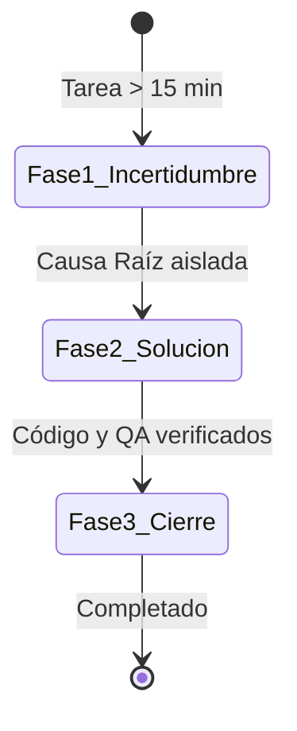

# 🔄 Protocolo de Living Tickets y Fases del SDLC
## Guía de Gestión Evolutiva de Tareas en Incertidumbre para Plane CE v1.2.3

**Ámbito:** Repositorios de trabajo (`Omnify`, `Operaciones`, servicios satélite)  
**Propósito:** Eliminar la falsa certeza y el sub-registro de horas permitiendo que los tickets nazcan con información parcial de diagnóstico y maduren hasta su cierre verificado.

---

## 1. El Ciclo de 4 Fases (SDLC propio)

Todo requerimiento técnico en la organización se clasifica en una de las 4 fases:

```
┌─────────────────┐     ┌─────────────────┐     ┌─────────────────┐     ┌─────────────────┐
│ 1. [SPIKE]      │ ──> │ 2. [RFC]        │ ──> │ 3. [FEAT/FIX]   │ ──> │ 4. [QA]         │
│ Diagnóstico/PoC │     │ Diseño/Schema   │     │ Construcción    │     │ Validación/Test │
└─────────────────┘     └─────────────────┘     └─────────────────┘     └─────────────────┘
```

1. `[SPIKE]` **Auditoría Forense & Diagnóstico:** Aislamiento de causa raíz, investigación técnica, análisis de datos en réplica y PoC descartable.
2. `[RFC]` **Análisis de Implementación & Diseño:** Modelado de schema de base de datos, contratos de API, especificaciones de arquitectura y diagramas de flujo.
3. `[FEAT/FIX/INFRA]` **Construcción & DevOps:** Implementación de código en frontend/backend, migraciones de base de datos, Docker, Caddy, endpoints.
4. `[QA]` **Testing & Validación Transaccional:** Pruebas unitarias/integración, validación en réplica con `ROLLBACK`, recálculo de balances y dry-runs.

---

## 2. La Regla de los 15 Minutos (Umbral de Creación)

Para evitar la creación de micro-tickets basura que destruyan las métricas del sprint y saturen el tablero Kanban:

* **Tareas < 15 minutos (Toil / Soporte Rápido):**  
  * *Acción:* **NO crear ticket en Omnify**.
  * *Destino:* Absorber en el ticket paraguas semanal de `OPS`:
    `Tareas Rápidas y Soporte - W{XX}`.
  * *Registro:* `plane-tracker comment add OPS-XX --track "soporte" --capacity "toil_support" --duration 10 -m "..."`.
* **Tareas > 15 minutos (Trabajo Estructurado):**  
  * *Acción:* Crear ticket formal en Plane **al minuto 15**.
  * *Destino:* Proyecto respectivo (`OMNIFY` por defecto, o `OPS`).
  * *Estado Inicial:* Nace bajo la **Plantilla de Incertidumbre (Fase 1)**.

---

## 3. Las Tres Fases del Living Ticket Pattern



### FASE 1: Estado Inicial (Triage & Incertidumbre)
**Cuándo se usa:** Al crear un bug, incidente o spike donde aún no se conoce la causa raíz ni la solución. Aplica estrictamente la **Pirámide Invertida (≤200 palabras)**:

```markdown
**Resumen:** [Qué falla exactamente y qué anomalía se investiga].

**Contexto & Síntoma:**
- Módulo: `nombre_modulo` (ej. Webhook Detonador SMS)
- Anomalía: [1 párrafo conciso con códigos o discrepancias clave].

**Hipótesis Preliminares:**
- [ ] Hipótesis A: [Posible causa 1]
- [ ] Hipótesis B: [Posible causa 2]

**Plan de Investigación (Spike Checklist):**
- [ ] Reproducir con payload idéntico en réplica de BD.
- [ ] Aislar la condición de carrera o línea exacta en logs.

*Evidencia forense, queries y datos de muestra: ver comentario [1] o adjunto.*
```
*(Toda traza extensa, snippet de código o query SQL se publica de inmediato como primer comentario con `plane-tracker comment add`, nunca dentro de la descripción).*

---

### FASE 2: Estado Intermedio (Causa Raíz Aislada ➔ Diseño y Solución)
**Cuándo se usa:** En cuanto se identifica el origen exacto del problema. Se actualiza la descripción en Plane mediante `plane-tracker update <TICKET> -d "..."`:

```markdown
**Resumen:** [Qué falla y qué se implementará para resolverlo].

**Contexto & Causa Raíz:**
[1 párrafo conciso explicando el fallo estructural aislado; referenciar ticket origen si aplica sin duplicar texto].

**Solución Propuesta:**
1. [Enfoque técnico 1: patrón, middleware o índice]
2. [Enfoque técnico 2: clave de idempotencia o mitigación]

**Criterios de Aceptación Técnicos (DoD):**
- [ ] Parche defensivo implementado en controlador o servicio.
- [ ] Migración o query ejecutada exitosamente con rollback seguro.
- [ ] Rama Git bajo patrón `{tipo}/{TICKET-ID}-{kebab}`.
- [ ] Pruebas unitarias / de integración pasando sin regresión.

*Detalle forense y análisis previo: ver comentarios o tickets enlazados.*
```

---

### FASE 3: Estado Final (Construcción, QA y Cierre)
**Cuándo se usa:** El código está mergeado, validado en réplica o staging, y listo para dar el ticket por concluido.

```markdown
**Resumen:** [Resumen de la solución completada].

**Criterios de Aceptación Técnicos (DoD):**
- [x] Parche defensivo implementado en el controlador o servicio respectivo.
- [x] Migración o query ejecutada exitosamente en entorno controlado con `ROLLBACK` seguro.
- [x] Rama Git creada bajo el patrón `fix/OMNIFY-180-mitigar-timeout-webhook`.
- [x] Pruebas transaccionales en réplica ejecutadas satisfactoriamente (Dry-Run exitoso).

**Entregables Verificables:**
- Archivo modificado: `src/controllers/webhook.controller.ts`
- Script de validación: `scripts/reconcile_campaign_credits.py`
- Pull Request: PR #42 (esperando revisión técnica del líder técnico)
```

Al marcar la Fase 3, se publica el comentario final con la bitácora corta (formato en `SKILL.md` §4):
```bash
plane-tracker comment add OMNIFY-180 -f /tmp/worklog_cierre.md --duration 95
plane-tracker update OMNIFY-180 --state "Completado"
```
