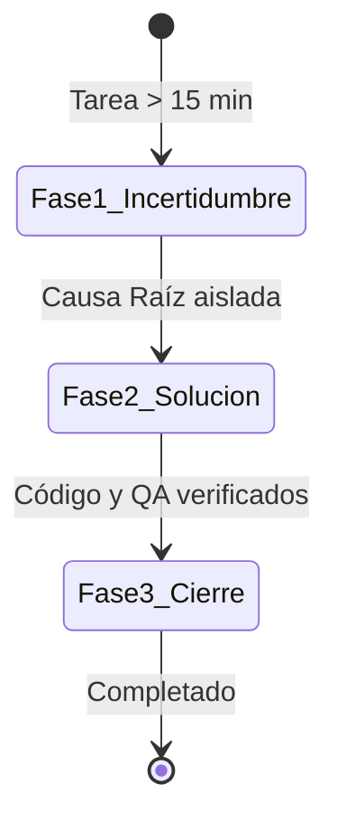

# 🔄 Protocolo de Living Tickets y Fases del SDLC
## Guía de Gestión Evolutiva de Tareas en Incertidumbre para Plane CE v1.2.3

**Ámbito:** Repositorios de trabajo (`Omnify`, `Operaciones`, servicios satélite)  
**Propósito:** Eliminar la falsa certeza y el sub-registro de horas permitiendo que los tickets nazcan con información parcial de diagnóstico y maduren hasta su cierre verificado.

---

## 1. El Ciclo de 4 Fases (SDLC de Johan)

Todo requerimiento técnico en la organización se clasifica en una de las 4 fases:

```
┌─────────────────┐     ┌─────────────────┐     ┌─────────────────┐     ┌─────────────────┐
│ 1. [SPIKE]      │ ──> │ 2. [RFC]        │ ──> │ 3. [FEAT/FIX]   │ ──> │ 4. [QA]         │
│ Diagnóstico/PoC │     │ Diseño/Schema   │     │ Construcción    │     │ Validación/Test │
└─────────────────┘     └─────────────────┘     └─────────────────┘     └─────────────────┘
```

1. `[SPIKE]` **Auditoría Forense & Diagnóstico:** Aislamiento de causa raíz, investigación técnica, análisis de datos en réplica y PoC descartable.
2. `[RFC]` **Análisis de Implementación & Diseño:** Modelado de schema de base de datos, contratos de API, especificaciones de arquitectura y diagramas de flujo.
3. `[FEAT/FIX/INFRA]` **Construcción & DevOps:** Implementación de código en frontend/backend, migraciones de base de datos, Docker, Caddy, endpoints.
4. `[QA]` **Testing & Validación Transaccional:** Pruebas unitarias/integración, validación en réplica con `ROLLBACK`, recálculo de balances y dry-runs.

---

## 2. La Regla de los 15 Minutos (Umbral de Creación)

Para evitar la creación de micro-tickets basura que destruyan las métricas del sprint y saturen el tablero Kanban:

* **Tareas < 15 minutos (Toil / Soporte Rápido):**  
  * *Acción:* **NO crear ticket en Omnify**.
  * *Destino:* Absorber en el ticket paraguas semanal de `OPS`:
    `Tareas Rápidas y Soporte - W{XX}`.
  * *Registro:* `plane-tracker comment OPS-XX --track "soporte" --capacity "toil_support" --duration 10 -m "..."`.
* **Tareas > 15 minutos (Trabajo Estructurado):**  
  * *Acción:* Crear ticket formal en Plane **al minuto 15**.
  * *Destino:* Proyecto respectivo (`OMNIFY` por defecto, o `OPS`).
  * *Estado Inicial:* Nace bajo la **Plantilla de Incertidumbre (Fase 1)**.

---

## 3. Las Tres Fases del Living Ticket Pattern



### FASE 1: Estado Inicial (Triage & Incertidumbre)
**Cuándo se usa:** Al crear un bug, incidente o spike donde aún no se conoce la causa raíz ni la solución.

```markdown
## Contexto & Detección
- Reportado por: [Área comercial / Monitoreo / Alerta de logs]
- Entorno: Producción / Staging
- Componentes involucrados: `módulo_afectado` (ej. Webhook Detonador SMS, Worker RabbitMQ)

## Comportamiento Observado (Síntoma)
Descripción detallada de la anomalía observada: mensajes de error en logs, códigos HTTP anómalos (504, 500) o discrepancias de conteo.

## Comportamiento Esperado
Qué debería suceder si el flujo transaccional operara de manera correcta según las reglas de negocio.

## Evidencia Inicial & Datos de Muestra
- IDs de muestra / Campañas / Fechas: `ID-XXXX`
- Errores de logs o snippets forenses preliminares.

## Hipótesis Preliminares & Puntos de Entrada
- [ ] Hipótesis A: Posible lock concurrente o saturación de pool de conexiones en Postgres/MySQL.
- [ ] Hipótesis B: Timeout de red por reintentos masivos de Meta / Proveedor SMS.

## Plan de Investigación (Spike Checklist)
- [ ] Reproducir el incidente con payload idéntico en réplica de base de datos.
- [ ] Inspeccionar queries lentas y transacciones concurrentes en el horario del reporte.
- [ ] Aislar la línea exacta de código o condición de carrera que detona la falla.
```

---

### FASE 2: Estado Intermedio (Causa Raíz Aislada ➔ Diseño y Solución)
**Cuándo se usa:** En cuanto el desarrollador o el agente identifican el origen exacto del problema. Se edita la descripción del ticket en Plane mediante `plane-tracker update` o la interfaz web.

```markdown
## Causa Raíz Confirmada (RCA - Root Cause Analysis)
Explicación técnica precisa del fallo estructural o bug identificado tras la auditoría forense.

## Solución Propuesta (Diseño Técnico & Arquitectura)
- Enfoque de implementación técnica (patrón transaccional, middleware defensivo, índices en BD).
- Contratos de API o cambios de esquema de base de datos.

## Requisitos y Restricciones Técnicas
- Compatibilidad con Plane CE v1.2.3, Docker, versiones de runtime (Node.js/Python).
- Variables de entorno o accesos de terceros requeridos.
- Impacto colateral en otros módulos o tablas.

## Criterios de Aceptación Técnicos (Definition of Done)
- [ ] Parche defensivo implementado en el controlador o servicio respectivo.
- [ ] Migración o query ejecutada exitosamente en entorno controlado con `ROLLBACK` seguro.
- [ ] Rama Git creada bajo el patrón corporativo `{tipo}/{TICKET-ID}-{kebab}`.
- [ ] Pruebas unitarias / de integración pasando sin regresiones.
```

---

### FASE 3: Estado Final (Construcción, QA y Cierre)
**Cuándo se usa:** El código está mergeado, validado en réplica o staging, y listo para dar el ticket por concluido.

```markdown
## Criterios de Aceptación Técnicos (Definition of Done)
- [x] Parche defensivo implementado en el controlador o servicio respectivo.
- [x] Migración o query ejecutada exitosamente en entorno controlado con `ROLLBACK` seguro.
- [x] Rama Git creada bajo el patrón `fix/OMNIFY-180-mitigar-timeout-webhook`.
- [x] Pruebas transaccionales en réplica ejecutadas satisfactoriamente (Dry-Run exitoso).

## Entregables Verificables
- Archivo modificado: `src/controllers/webhook.controller.ts`
- Script de validación: `scripts/reconcile_campaign_credits.py`
- Pull Request: PR #42 (esperando revisión técnica de Pierre)
```

Al marcar la Fase 3, se publica el comentario final con la **Bitácora Dual-Layer**:
```bash
plane-tracker comment OMNIFY-180 -f /tmp/worklog_cierre.md --duration 95
plane-tracker update OMNIFY-180 --state "Completado"
```
